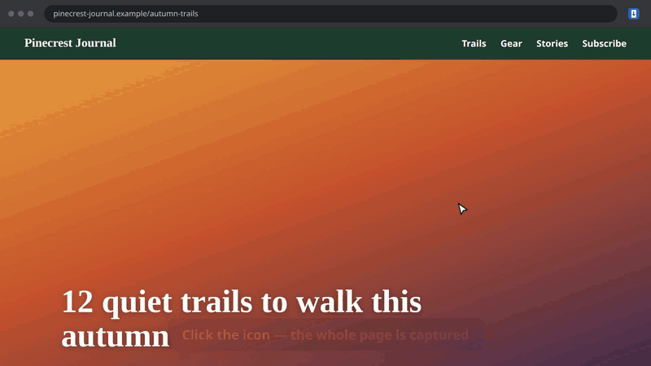

# FX Full Page Screenshot

**Screenshot the entire page — top to bottom — in one click.** Then crop it, highlight what matters,
blur what's private, and export it as PNG, JPG or PDF. No account, no tracking: everything stays on
your computer.

▶️ [Watch the 25-second demo on YouTube](https://www.youtube.com/watch?v=djICF5qt5hs)

## Install

| Browser | Store |
|---|---|
| Chrome, Brave, Opera, Vivaldi | [Chrome Web Store](https://chromewebstore.google.com/detail/gcgmabhlaegopkahoagdhcchbajfccad) |
| Firefox | [Firefox Add-ons](https://addons.mozilla.org/firefox/addon/fx-full-page-screenshot/) |
| Microsoft Edge | Microsoft Edge Add-ons (link coming soon) |

Or download a package from the [latest release](https://github.com/fx-diff/fxfullpage/releases/latest).

## Features

- One-click full page capture (toolbar icon or **Alt+Shift+S**)
- Visible area (**Alt+Shift+V**) or a selected area (**Alt+Shift+A**), also from the icon's right-click menu
- Works on long pages and on web apps with their own scrolling area
- Sticky headers and cookie banners show up once, not on every screen
- Extra-long pages are split automatically into several images
- Editor: crop, arrows, text, colored boxes (three sizes), blur/pixelate, undo
- Optional URL and capture-date stamp on PNG, JPG, PDF and clipboard exports
- Export to PNG, JPG or multi-page PDF, or copy to the clipboard
- English and French interface
- Private by design: no network requests, minimal permissions (`activeTab`, `scripting`, `contextMenus`)

## Installation (development)

### Chrome

1. Open `chrome://extensions`
2. Turn on **Developer mode** (top right)
3. Click **Load unpacked** and select this folder
4. (Optional) Pin the icon to the toolbar

> After changing `manifest.json` or anything in `_locales/`, click the reload button ↻ on the extension card.
> Chrome reads JS/HTML files from disk live, but only reads the manifest and translations when the extension is loaded.

### Firefox

1. Run `./scripts/package.sh firefox`
2. Open `about:debugging#/runtime/this-firefox`
3. Click **Load Temporary Add-on…** and select `dist/firefox/manifest.json`

The temporary add-on is removed when Firefox restarts. Re-run the script and click **Reload** after each change.

## Usage

- Click the icon, or press **Alt+Shift+S**, to capture the full page.
- Right-click the icon (or press **Alt+Shift+V** / **Alt+Shift+A**) to capture the visible area or drag a selection.
- Shortcuts are configurable in `chrome://extensions/shortcuts` (Firefox: `about:addons` → ⚙ → Manage Extension Shortcuts).
- Progress is shown on the icon badge (%). Do not switch tabs during the capture.
- The editor opens in a new tab:

| Action | Shortcut |
|---|---|
| Crop (draw an area, then Enter or ✓) | `C` |
| Colored box | `R` |
| Arrow | `A` |
| Text (click, type, Enter) | `T` |
| Blur / pixelate an area | `B` |
| Undo | `Ctrl+Z` |
| Fit / actual size | `Z` |
| Copy to clipboard | `Ctrl+C` |
| Download as PNG | `Ctrl+S` |
| Clear the selection | `Esc` |

Exports: PNG, JPG, PDF (A4 pages, using the width of the capture).

## How it works

- `background.js` scrolls the page one screen at a time, calls `chrome.tabs.captureVisibleTab`
  (limited to 2 calls per second) and stitches the frames into an `OffscreenCanvas`.
- `select-area.js` shows the drag-to-select overlay for area captures and reports the rectangle back.
- `capture-page.js` is injected into the page. It hides scrollbars, puts `sticky` elements back into
  the normal flow, hides `fixed` elements after the first frame (so headers are not repeated), and
  restores everything at the end. If the document itself does not scroll (Gmail, Notion…), it captures
  the largest scrollable container instead.
- Very tall pages are split into several images (browser canvas limit is about 32,000 px).
- `db.js` keeps the 10 most recent captures in IndexedDB.
- `editor.*` is the editor; `pdf.js` is a small dependency-free PDF writer.

## Languages

The UI is in English (default) and French, depending on the Chrome language. Strings live in
`_locales/<language>/messages.json`.

## Building and publishing

`./scripts/package.sh` builds every package from the same source (or pass `chrome`, `firefox` or `edge`):

| Target | Unpacked build | Package to upload | Store |
|---|---|---|---|
| Chrome | `dist/chrome/` | `dist/fxfullpage-chrome-<version>.zip` | Chrome Web Store |
| Edge | `dist/edge/` | `dist/fxfullpage-edge-<version>.zip` | Microsoft Edge Add-ons (same files as Chrome) |
| Firefox | `dist/firefox/` | `dist/fxfullpage-firefox-<version>.zip` | addons.mozilla.org (AMO) |

`manifest.json` is the Chrome manifest. The Firefox manifest is generated from it: a background
script (event page) instead of a service worker, plus `browser_specific_settings.gecko`
(add-on ID, minimum version 142, and `data_collection_permissions: none`). There is deliberately
no `gecko_android` key, so the add-on is not marked as compatible with Firefox for Android.

- Bump `version` in `manifest.json` before every new submission.
- Validate the Firefox build with `cd dist/firefox && npx web-ext lint`.
- Listing copy and images: `store/LISTING.md` (Chrome Web Store), `store/EDGE.md` (Edge), `store/AMO.md` (Firefox).
- Privacy policy: `PRIVACY.md`.

## Known limitations

- Browser-internal pages cannot be captured: `chrome://` and `about:` pages, the Chrome Web Store,
  addons.mozilla.org and the built-in PDF viewers.
- Infinite-scroll pages are captured at the height they had when the capture started.
- Scroll-triggered animations can leave visible seams.

## License

[MIT](LICENSE) © 2026 Francois-Xavier Degroot
